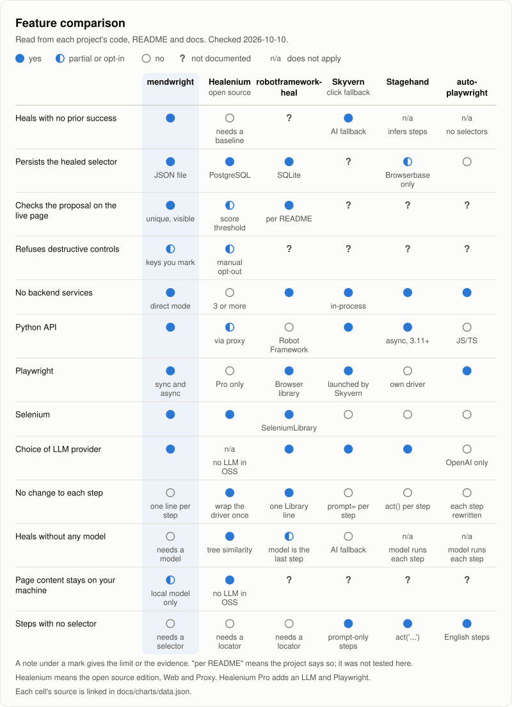

<div align="center">

<picture>
  <source media="(prefers-color-scheme: dark)" srcset="https://raw.githubusercontent.com/saadbuilt/mendwright/main/docs/assets/logo-dark.svg">
  
</picture>

Playwright and Selenium selectors that repair themselves when a site changes.

On a 47-case benchmark of hand-built redesigns: 30 of 35 broken selectors repaired, and 1 wrong element in 47 cases ([every case, misses included](https://github.com/saadbuilt/mendwright/blob/main/benchmarks/RESULTS.md)).

[](https://pypi.org/project/mendwright/)
[](https://www.npmjs.com/package/mendwright)
[](https://pypi.org/project/mendwright/)
[](https://github.com/saadbuilt/mendwright/actions/workflows/ci.yml)
[](https://github.com/saadbuilt/mendwright/blob/main/LICENSE)

</div>

```bash
pip install mendwright
mendwright demo   # a redesign breaks two selectors: one is repaired, the pay button is refused. Offline: no browser, no API key
```

https://github.com/user-attachments/assets/5367abb9-4ffb-45c8-8af2-fa5939d735cb

<p align="center"><sub>A redesign breaks three selectors. mendwright repairs them, the next run passes in 0.25 s, a promotion is declined and a confirm dialog is answered. Real runs, waits sped up.</sub></p>

A front-end deploy renames `#terms`, and your nightly run dies on a step that is still on the page. mendwright fixes that step while the script runs.

When a selector works, mendwright saves what the element looked like: its tag, id, name, label and nearby text. When the selector breaks, it looks for that element on the new page, and uses a match only if exactly one visible element with the same role fits. The saved details are often enough, with no API key. When they aren't, or the selector never matched, it asks a model, which can be a 1 GB one on your own machine. Repairs are saved in `.mendwright/overrides.json`, plain JSON, so the next run reuses them without asking anything, and `mendwright fix` writes them into your code.

Existing suite? Change one line, `page = mendwright.open(page).page`, and the [calls listed here](https://github.com/saadbuilt/mendwright/blob/main/docs/guide.md#no-changes-per-step) repair themselves with no other edits.

## Quickstart

```python
from playwright.sync_api import sync_playwright
import mendwright

with sync_playwright() as p:
    page = p.chromium.launch().new_page()
    page.goto("https://example.com/signup")

    heal = mendwright.open(page)
    heal.locator("email", "#email").fill("ada@example.com")
    heal.locator("accept_terms", "//input[@id='terms']", role="checkbox").check()
    heal.locator("create_account", "#create-account").click()
```

`heal.locator()` takes the selector you would pass to `page.locator()`, plus a name, like `"email"`, that the repair is saved under. `role=` is optional: mendwright learns it the first time the selector matches, so pass it only when you add mendwright to a suite whose selectors may already be broken.

The one-line version for a script you don't want to touch:

<!-- readme-test: wrappers -->
```python
page = mendwright.open(page).page          # Playwright
page.fill("#email", "ada@example.com")
page.check("#terms")

driver = mendwright.open(driver).driver    # Selenium (By from selenium.webdriver.common.by)
driver.find_element(By.ID, "terms").click()
```

Here the selector string is the name.

For a model, run the local one (below), or set a hosted provider's key and model:

```bash
export ANTHROPIC_API_KEY="sk-ant-..."
export ANTHROPIC_MODEL="..."      # a current model id from Anthropic's model list
```

`OPENAI_API_KEY` with `OPENAI_MODEL`, `GEMINI_API_KEY` with `GEMINI_MODEL`, and `OLLAMA_MODEL` work the same way, and `mendwright doctor` shows what it found. With no model, repairs from the saved details still happen, and anything else raises an error that says what to set.

## Why you can trust a repair, and where you shouldn't

A tool that clicks the wrong button is worse than a failing test. mendwright refuses rather than guesses:

- **Checked on the live page.** A repair is used only if it matches exactly one visible element with the step's role (checkbox, button, link and so on; a hidden checkbox is allowed), and never a bare position like `/html[1]/body[1]/div[3]`.
- **Steps you mark are never repaired.** Pass `destructive=True` for pay, submit or delete, and mendwright stops and tells you instead. It can't know which other steps are dangerous: the checks stop ambiguous, hidden and wrong-kind targets, not a plausible button of the same kind, so mark them.
- **Not on a page it wasn't found on.** A key is only repaired on URL paths it was seen on, so a missing Continue button doesn't become the Help button on the next page. A step that moved while the path stayed the same isn't covered.
- **Failed repairs are quarantined.** If the action on a repaired element raises, or an `expect=` or `expect_value=` check fails, the repair is never used again. A wrong click that succeeds isn't caught this way, so `mendwright report` lists repairs no passing test has confirmed.
- **Reads are checked if you ask.** `heal.locator("price", "#price", expect_value="money")` refuses a repair that reads `4.5` where a price should be.
- **Repairs don't hide drift unless you let them.** By default a repaired test passes with one log line. `pytest --mendwright-strict` fails it instead, with the old and the new selector (give strict jobs a fresh store), and `mendwright notify` tells your team.

When mendwright won't repair a step, it says why and what to do:

<!-- readme-test: attention-pay -->
```text
mendwright.exceptions.AttentionRequired: No matching element for: pay (tried 1 candidate(s)).
  -> 'pay' is marked as a destructive control, and mendwright never auto-heals those, because a validated but wrong selector here could act on a live account. Fix the selector in your code or seed file by hand.
```

Other questions people ask:

- **Is it deterministic?** The saved-details match is. A model is asked only when that match isn't confident, and once a repair is saved it is reused, so later runs ask nothing.
- **What does it cost?** Nothing when the saved details are enough, which is also the case on every later run. A model prompt is about 2,500 tokens, at most 2 calls per attempt, and attempts are capped at 3 per key and 60 in all, per hour.
- **Is it slow?** A broken selector waits `MENDWRIGHT_TIMEOUT_MS` (10 s) before a repair, as a normal wait would. On the next run the saved repair is found on the first try.
- **Why not just use `data-testid`?** Use it where you can; mendwright reads test ids too. It is for markup you don't control, and for suites already written.
- **What if I stop using it?** `mendwright fix --apply` writes the repaired selectors into your code, and removing mendwright is one line.

## How well it works

On a [47-case benchmark](https://github.com/saadbuilt/mendwright/blob/main/docs/benchmark.md) of hand-built pages that mimic common redesigns (ids renamed, hashed classes, new wrappers, reworded labels), plus 12 cases where the right answer is to not repair:

| | Repaired (of 35) | Wrong element (of 47 cases) |
|---|---|---|
| Saved details alone, no model | 20 | 0 |
| Plus mendwright's own local model, headless Chromium | 30 | 1 |

Both rows are in-sample: the thresholds were tuned on these cases, and the local model was revised after its misses here, so expect a wrong repair now and then on your pages. The model runs used mendwright 0.4.0; the saved-details row is re-checked by the test suite on every commit. No hosted-model numbers are published yet. The [results](https://github.com/saadbuilt/mendwright/blob/main/benchmarks/RESULTS.md) list every case and every miss.

## More than broken selectors

Pages also change in ways that aren't a broken selector. Each of these is off until you ask for it:

- **Cookie banners** from the common consent managers: `mendwright.open(page, cookies="reject")`.
- **Interruptions you know about**, such as a newsletter modal, an "are you still there?" dialog or a session-expired sign-in: register them once with `heal.interrupt()` and they are handled wherever they open. `run=` takes a function for ones that need a form.
- **Popups you didn't know about**, with `dismiss=True`. When one covers the element of an action, mendwright presses Escape, then a close button, then a decline button such as No thanks, chosen by its label. It never clicks Subscribe, Accept, a priced button, or Continue (except "Continue without..."), though it can't see what a button's own script does.
- **Steps in a different order**, such as a checkout that now asks for the card before the address: `heal.step()` and `heal.run_steps()`.
- **Iframes** one level down, and **open shadow roots** at any depth.
- **Playwright's `get_by_role()` and the other `get_by_*` calls**, with `heal_get_by=True`, repaired from the saved details only.

<!-- readme-test: flow -->
```python
heal = mendwright.open(page, cookies="reject")      # close common consent banners
heal.interrupt("newsletter", "#newsletter-close")   # your own modal, wherever it opens

heal.locator("email", "#email").fill("ada@example.com")
heal.locator("create_account", "#create-account").click()
```

Each has its own section, and most have a short clip, in the [guide](https://github.com/saadbuilt/mendwright/blob/main/docs/guide.md).

## In CI

- `mendwright check --base-url https://your.site` loads the pages your selectors were last found on and reports which ones broke, before the nightly run. It doesn't save anything or call a model, and it clicks nothing but a consent banner when you pass `--cookies`.
- `mendwright fix --apply` writes confirmed repairs into your code, as CSS where your code used CSS.
- The GitHub Action does that after your tests and opens a pull request for you to review ([guide](https://github.com/saadbuilt/mendwright/blob/main/docs/guide.md#open-a-pull-request-with-the-fixes)).
- `mendwright notify` posts a summary to Slack or any webhook: what was repaired and what needs a human. It sends counts and key names, never page text or form values, and `--detail counts` leaves the names out. The URL comes from `MENDWRIGHT_WEBHOOK_URL`.

## Selenium, async and pytest

```python
from selenium import webdriver
import mendwright

driver = webdriver.Chrome()
driver.get("https://example.com/signup")

heal = mendwright.open(driver)
heal.locator("email", "#email").fill("ada@example.com")
heal.locator("accept_terms", "//input[@id='terms']", role="checkbox").check()
driver.quit()
```

Playwright verbs like `fill()` and `check()` work on Selenium too, so step code reads the same on both.

```python
import asyncio
from playwright.async_api import async_playwright
import mendwright.aio

async def main():
    async with async_playwright() as p:
        browser = await p.chromium.launch()
        page = await browser.new_page()
        await page.goto("https://example.com/signup")

        heal = await mendwright.aio.open(page)
        await heal.locator("accept_terms", "//input[@id='terms']", role="checkbox").check()

asyncio.run(main())
```

```python
def test_signup(page, heal):
    page.goto("https://example.com/signup")
    heal.locator("email", "#email").fill("ada@example.com")
    heal.locator("accept_terms", "//input[@id='terms']", role="checkbox").check()
```

The `heal` fixture comes from mendwright's pytest plugin, which loads on its own and wraps pytest-playwright's `page`. Selenium suites point it at their own fixture with `mendwright_page_fixture`. A repair is marked confirmed when its test passes.

## TypeScript

A port for Playwright Test is on npm. It has this package's fingerprint scoring, checks and store format, so Python and TypeScript suites can share one store:

```ts
import { test, expect } from 'mendwright/test';   // instead of '@playwright/test'
```

It does less than the Python package for now (no `dismiss`, `expect_value`, iframe or shadow-root repairs yet). See [js/README.md](https://github.com/saadbuilt/mendwright/blob/main/js/README.md).

## A model that runs on your machine

`mendwright-selector` is a 1 GB fine-tune of Qwen2.5-1.5B that answers one question: which element on this page did the broken step mean, if any. It picks from a numbered list, mendwright builds the selector itself, and the usual checks still apply, so the model never writes a selector.

```bash
mendwright model install                      # needs Ollama; checks the file's SHA-256
export MENDWRIGHT_LOCAL_MODEL=mendwright-selector
```

It answers in about a quarter of a second on a laptop GPU, or about 1.5 s on a CPU, and the page never leaves your machine. On 3,000 held-out synthetic redesigns from its own generator, it picked the right element for 97.1% of steps (94.6% of those the saved details couldn't place) and a wrong one for 0.14% (0.36%). When the element was gone, it still picked one 2.9% of the time. [training/README.md](https://github.com/saadbuilt/mendwright/blob/main/training/README.md) has the generator and the recipe.

## Compared with other tools

<picture>
  <source media="(prefers-color-scheme: dark)" srcset="https://raw.githubusercontent.com/saadbuilt/mendwright/main/docs/assets/feature-matrix-dark.svg">
  
</picture>

Healenium is the better fit for Java, and for any Selenium client through its proxy. Robot Framework suites have robotframework-heal. Agent tools such as Stagehand and Skyvern suit steps written in plain English. [docs/comparison.md](https://github.com/saadbuilt/mendwright/blob/main/docs/comparison.md) has a source for every cell.

## Limits

- Repairs are saved as XPath, with a CSS form when your code used CSS and CSS can name the element; repairs inside a shadow root are CSS. Closed shadow roots are out of reach.
- With a hosted model, a cleaned copy of the page is sent whenever the saved details aren't enough. Redaction is best-effort: it removes field values, absolute URLs and long digit runs, but visible text and most attributes stay. The local model keeps the page on your machine. See [SECURITY.md](https://github.com/saadbuilt/mendwright/blob/main/SECURITY.md).
- A list that matches nothing is never repaired while the script runs, because an emptied cart looks the same as a broken selector. `heal.locator_all(..., nonempty=True)` proposes a fix for you to accept instead.
- It repairs a selector on the page the script is on. A step that moved to another page, or a new required step, still needs you.
- Positional selectors like `(//form//input)[1]` can quietly point at the wrong field after a redesign, because nothing broke. Anchor on ids, names, labels or text.

## Links

- [Guide](https://github.com/saadbuilt/mendwright/blob/main/docs/guide.md): every option, the pytest plugin, CI recipes, the CLI and troubleshooting
- [Changelog](https://github.com/saadbuilt/mendwright/blob/main/CHANGELOG.md), [Contributing](https://github.com/saadbuilt/mendwright/blob/main/CONTRIBUTING.md), [Security](https://github.com/saadbuilt/mendwright/blob/main/SECURITY.md)

[MIT license](https://github.com/saadbuilt/mendwright/blob/main/LICENSE). If mendwright saved a run for you, a star helps other people find it.
