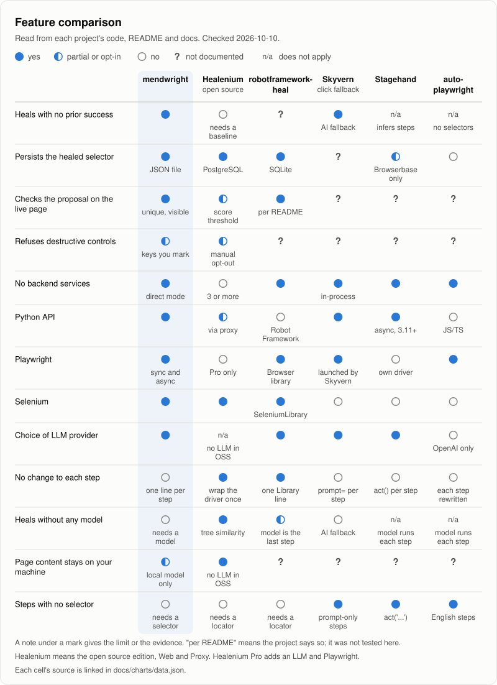
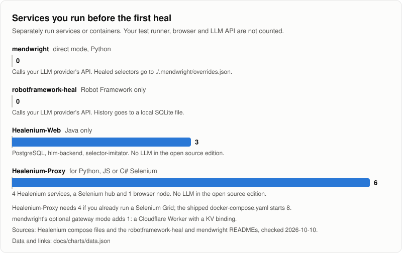
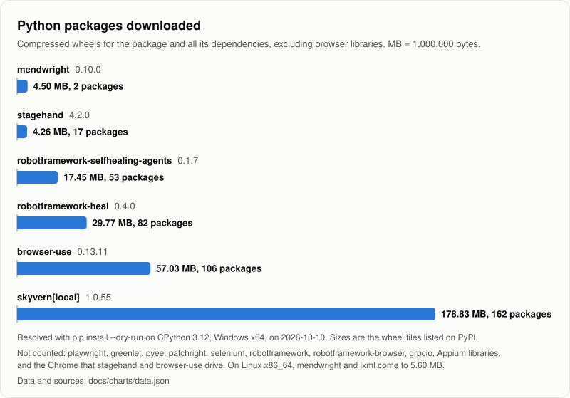
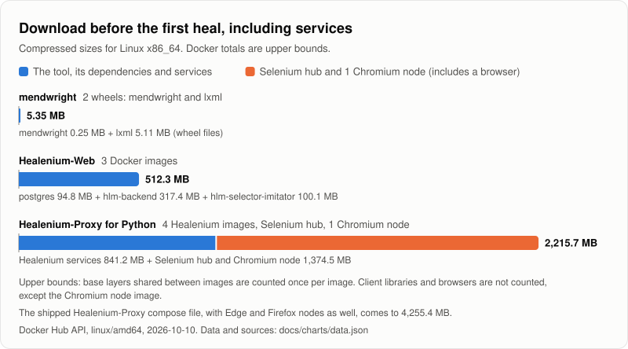

# Comparison with other tools

How mendwright compares with other tools that repair, or avoid, broken selectors in browser automation.
Every fact about another tool links to the README, docs page, compose file or package index entry it came from, all read on 2026-10-10.

The numbers behind the charts are in [charts/data.json](charts/data.json), each with its source and method.
[charts/build_charts.py](charts/build_charts.py) draws the charts from that file and nothing else.

Repair accuracy (how often a heal picks the right element) wasn't compared between tools.
mendwright's own accuracy without a model is measured on its [47-case benchmark](benchmark.md), with thresholds tuned on those same cases.

## What was compared

| Tool | Version | What it is |
|---|---|---|
| mendwright | 0.6.0 | Python library. Repairs a broken selector at run time from a saved fingerprint of the element, or with a model when that match isn't confident, checks the new XPath locally, saves it. |
| [Healenium](https://healenium.io/docs/overview) (open source) | healenium-web 3.6.0, hlm-proxy 2.2.1 | Java library, or a proxy for any Selenium client. Tree similarity against a stored baseline, no LLM. |
| [robotframework-heal](https://github.com/manykarim/robotframework-heal) | 0.4.0 | Robot Framework listener. Deterministic candidates first, then an LLM pick. |
| [robotframework-selfhealing-agents](https://github.com/MarketSquare/robotframework-selfhealing-agents) | 0.1.7 | Robot Framework library. An LLM multi-agent workflow repairs locators. |
| [Skyvern](https://github.com/Skyvern-AI/skyvern) | 1.0.55 | AI browser agent. Its `page.click(selector, prompt=...)` tries the selector first and falls back to AI. |
| [Stagehand](https://github.com/browserbase/stagehand) | 4.2.0 | AI browser driver with `act()`, `observe()` and `extract()`. |
| [browser-use](https://github.com/browser-use/browser-use) | 0.13.11 | AI agent that completes a task described in English. Footprint only below, since it doesn't plug into an existing script. |
| [auto-playwright](https://github.com/lucgagan/auto-playwright) | 1.16.1 | TypeScript. Each step is an English instruction sent to OpenAI. |

Commercial tools (mabl, testRigor, Testim, Katalon) are left out.
Their public pages don't say enough to fill in the rows below.

## Features

<picture>
  <source media="(prefers-color-scheme: dark)" srcset="assets/feature-matrix-dark.svg">
  
</picture>

"Partial" means partly, opt-in, or with a stated limit.
"Not documented" means the project's docs didn't say, so the answer is unknown.

| | mendwright | Healenium (open source) | robotframework-heal | Skyvern (click fallback) | Stagehand | auto-playwright |
|---|---|---|---|---|---|---|
| Heals with no prior success | yes ([stub run](#methodology)) | no, [needs a baseline](https://healenium.io/docs/how_healenium_works) | [not documented](https://github.com/manykarim/robotframework-heal) | yes, [AI fallback](https://www.skyvern.com/docs/sdk-reference/browser-automation/click.md) | n/a, [infers each step](https://github.com/browserbase/stagehand) | n/a, [no selectors](https://github.com/lucgagan/auto-playwright) |
| Persists the healed selector | yes, [JSON file](../mendwright/store.py) | yes, [PostgreSQL](https://github.com/healenium/healenium/blob/master/docker-compose-web.yaml) | yes, [SQLite](https://github.com/manykarim/robotframework-heal) | [not documented](https://www.skyvern.com/docs/developers/features/code-caching.md) | partial, [Browserbase only](https://docs.stagehand.dev/v4/best-practices/caching) | [no](https://github.com/lucgagan/auto-playwright) |
| Checks the proposal on the live page | yes, [unique and visible](../mendwright/gate.py) | partial, [score threshold](https://github.com/healenium/healenium-selector-imitator) | yes, [per README](https://github.com/manykarim/robotframework-heal) | [not documented](https://www.skyvern.com/docs/sdk-reference/browser-automation/click.md) | [not documented](https://github.com/browserbase/stagehand) | [not documented](https://github.com/lucgagan/auto-playwright) |
| Refuses destructive controls | partial, [keys you mark](../mendwright/coordinator.py) (`destructive=True`, `destructive_keys` or the seed file) | partial, manual opt-out ([Java](https://github.com/healenium/healenium-web), [proxy](https://github.com/healenium/healenium-proxy)) | [not documented](https://github.com/manykarim/robotframework-heal) | [not documented](https://github.com/Skyvern-AI/skyvern) | [not documented](https://github.com/browserbase/stagehand) | [not documented](https://github.com/lucgagan/auto-playwright) |
| No backend services | yes, [direct mode](../README.md) | no, [3 or more](https://github.com/healenium/healenium/blob/master/docker-compose-web.yaml) | [yes](https://github.com/manykarim/robotframework-heal) | yes, [in-process](https://github.com/Skyvern-AI/skyvern) | [yes](https://github.com/browserbase/stagehand) | [yes](https://github.com/lucgagan/auto-playwright) |
| Python API | [yes](../pyproject.toml) | partial, [via the proxy](https://github.com/healenium/healenium-proxy) | no, [Robot Framework](https://github.com/manykarim/robotframework-heal) | [yes](https://github.com/Skyvern-AI/skyvern) | yes, [async, Python 3.11+](https://github.com/browserbase/stagehand/blob/main/packages/sdk-python/README.md) | no, [JS/TS](https://github.com/lucgagan/auto-playwright) |
| Playwright | yes, [sync and async](../mendwright/aio.py) | no, [Pro only](https://healenium.io/docs/playwright_proxy) | yes, [Browser library](https://github.com/manykarim/robotframework-heal) | yes, [launched by Skyvern](https://github.com/Skyvern-AI/skyvern) | no, [own driver](https://github.com/browserbase/stagehand) | [yes](https://github.com/lucgagan/auto-playwright) |
| Selenium | [yes](../mendwright/drivers/selenium.py) | [yes](https://github.com/healenium/healenium-web) | yes, [SeleniumLibrary](https://github.com/manykarim/robotframework-heal) | [no](https://github.com/Skyvern-AI/skyvern) | [no](https://github.com/browserbase/stagehand) | [no](https://github.com/lucgagan/auto-playwright) |
| Choice of LLM provider | yes, [see Providers](../README.md) | n/a, [no LLM in open source](https://healenium.io/docs/ai) | [yes](https://github.com/manykarim/robotframework-heal) | [yes](https://github.com/Skyvern-AI/skyvern) | [yes](https://github.com/browserbase/stagehand) | no, [OpenAI only](https://github.com/lucgagan/auto-playwright) |
| No change to each step | yes, [heal.page / heal.driver](guide.md#no-changes-per-step) (chained locators, `get_by_*` and other `By` values pass through unhealed) | yes, [wrap the driver once](https://github.com/healenium/healenium-web) | yes, [one Library line](https://github.com/manykarim/robotframework-heal) | no, [prompt= per step](https://github.com/Skyvern-AI/skyvern) | no, [act() per step](https://github.com/browserbase/stagehand/blob/main/packages/sdk-python/README.md) | no, [each step rewritten](https://github.com/lucgagan/auto-playwright) |
| Heals without any model | yes, [fingerprint first](guide.md#heals-without-a-model), a model only when the match isn't confident | yes, [tree similarity](https://healenium.io/docs/how_healenium_works) | partial, [model is the last step](https://github.com/manykarim/robotframework-heal) | no, [AI fallback](https://www.skyvern.com/docs/sdk-reference/browser-automation/click.md) | n/a, [model runs each step](https://github.com/browserbase/stagehand) | n/a, [model runs each step](https://github.com/lucgagan/auto-playwright) |
| Page content stays on your machine | partial, [with no provider or a local model](../SECURITY.md#redaction) | yes, [no LLM in open source](https://healenium.io/docs/how_healenium_works) | [not documented](https://github.com/manykarim/robotframework-heal) | [not documented](https://github.com/Skyvern-AI/skyvern) | [not documented](https://github.com/browserbase/stagehand) | [not documented](https://github.com/lucgagan/auto-playwright) |
| Steps with no selector | partial, [`intent=` and `role=`](guide.md#describing-an-element-with-intent): a model finds it once | no, [needs a locator](https://github.com/healenium/healenium-web) | no, [needs a locator](https://github.com/manykarim/robotframework-heal) | yes, [prompt-only steps](https://github.com/Skyvern-AI/skyvern) | yes, [act('...')](https://github.com/browserbase/stagehand) | yes, [English steps](https://github.com/lucgagan/auto-playwright) |

How each row was judged:

- Heals with no prior success: the tool can repair a selector it never saw work. n/a when it stores no selectors.
- Persists the healed selector: the repair is written somewhere the next run reads it.
- Checks the proposal on the live page: "yes" means a uniqueness check or a live re-check. "Partial" means a similarity score threshold only.
- Refuses destructive controls: "yes" means pay, submit or delete style controls are refused without marking each one. "Partial" means only steps you mark are refused. The same rule was applied to every tool, so Healenium's `@DisableHealing` and mendwright's `destructive=True` both count as partial.
- No backend services: no separately run service or container. An LLM API doesn't count.
- No change to each step: existing steps keep working after a one-time setup. "No" means every step is rewritten or gets an extra argument. See [Integration effort](#integration-effort).
- Heals without any model: the repair needs no LLM call and no model set up. "Partial" means a deterministic repair runs first, but the setup needs a model. "n/a" means the tool asks a model for every step. mendwright's fingerprint tier heals with no provider at all, and asks a model only when one is configured and the match isn't confident.
- Page content stays on your machine: no page content goes to a model provider. "Partial" means only in some setups: for mendwright, with no provider (fingerprint heals only) or a local model. Judged on the open source edition.
- Steps with no selector: a step can be written in plain English, with no selector at all. mendwright's `intent=` counts as partial, because it also needs `role=` and a model, and the element is found once and then saved as an XPath.
- Healenium Pro adds a bring-your-own LLM and Playwright support ([AI](https://healenium.io/docs/ai), [Playwright](https://healenium.io/docs/playwright_proxy)). Only the open source edition is rated here.

## Integration effort

mendwright runs no services and, with `heal.page` or `heal.driver`, needs no per-step change, like Healenium and the Robot Framework libraries.
`heal.locator()` is the per-step form, for a key name, `role=` or `destructive=` on a step.

| Tool | One-time code | Per-step change | Config | Services |
|---|---|---|---|---|
| mendwright | 2 lines: `import mendwright`, `page = mendwright.open(page).page` (or `heal = mendwright.open(page)`) | none with `heal.page` or `heal.driver`; with `heal.locator()`, `page.locator(xpath)` becomes `heal.locator(key, xpath, role=...)` | none for fingerprint heals; for a model, 2 env vars: `<PROVIDER>_API_KEY`, `<PROVIDER>_MODEL` | 0 |
| [Healenium-Web](https://github.com/healenium/healenium-web) | an import, and driver creation replaced by 2 lines (`SelfHealingDriver.create(delegate)`) | none | a dependency block (Maven 5 lines or Gradle 1) and a 5-line `healenium.properties` | 3 |
| [Healenium-Proxy, Python](https://github.com/healenium/healenium-example-python) | about 2 lines: the local driver becomes `webdriver.Remote('http://localhost:8085', options=...)` | none | the docker-compose file | 6 |
| [robotframework-heal](https://github.com/manykarim/robotframework-heal) | 1 line in Settings: `Library    Heal` | none | 3 `.env` lines: `HEAL_MODEL`, `HEAL_BASE_URL`, `HEAL_API_KEY` | 0 |
| [robotframework-selfhealing-agents](https://github.com/MarketSquare/robotframework-selfhealing-agents) | 1 line: `Library    SelfhealingAgents` | none | 1 `.env` line: `OPENAI_API_KEY` | 0 |
| [Skyvern](https://github.com/Skyvern-AI/skyvern) | launch the client and the browser through Skyvern (`Skyvern.local()`, a launch call, `get_working_page()`) | add `prompt='...'` to each `page.click`, `fill` or `select_option` | a `.env` file | 0 with `Skyvern.local()` |
| [Stagehand, Python](https://github.com/browserbase/stagehand/blob/main/packages/sdk-python/README.md) | adopt its driver: launch, `Stagehand.create`, close | each step becomes `stagehand.act('...')` or uses a selector from `observe()` | a provider/model string and your key | 0 (Browserbase is optional) |
| [auto-playwright](https://github.com/lucgagan/auto-playwright) | 1 import | every step is rewritten as `auto('...', { page, test })` | `OPENAI_API_KEY` | 0 |

## Footprint

### Services before the first heal

<picture>
  <source media="(prefers-color-scheme: dark)" srcset="assets/compare-services-dark.svg">
  
</picture>

| Tool | Services | Which | Calls an LLM API |
|---|---|---|---|
| mendwright, direct mode | 0 | none; healed selectors go to `./.mendwright/overrides.json` | only when a fingerprint match isn't confident and a provider is set up |
| [robotframework-heal](https://github.com/manykarim/robotframework-heal) | 0 | none; history goes to a local SQLite file | yes |
| [Healenium-Web](https://github.com/healenium/healenium/blob/master/docker-compose-web.yaml) (Java only) | 3 | PostgreSQL, hlm-backend, selector-imitator | no |
| [Healenium-Proxy](https://github.com/healenium/healenium/blob/master/docker-compose.yaml) (Python, JS or C# Selenium) | 6 | the 3 above, hlm-proxy, a Selenium hub, 1 browser node | no |

Healenium-Proxy needs 4 if you already run a Selenium Grid. Its shipped `docker-compose.yaml` starts 8.
mendwright's optional gateway mode adds 1: a Cloudflare Worker with a KV binding ([examples/heal_gateway.mjs](../examples/heal_gateway.mjs)).

### Python packages downloaded

<picture>
  <source media="(prefers-color-scheme: dark)" srcset="assets/compare-download-dark.svg">
  
</picture>

| Package | Version | Compressed wheels | Packages | Note |
|---|---|---|---|---|
| mendwright | 0.6.0 | 4.26 MB | 2 | mendwright and lxml. 5.36 MB on Linux x86_64. See [Methodology](#mendwright-wheel). |
| [stagehand](https://pypi.org/pypi/stagehand/4.2.0/json) | 4.2.0 | 4.26 MB | 17 | No Playwright dependency; it drives a Chrome you install. |
| [robotframework-selfhealing-agents](https://pypi.org/pypi/robotframework-selfhealing-agents/0.1.7/json) | 0.1.7 | 17.45 MB | 53 | 37.08 MB in 59 packages with Robot Framework and browser libraries. |
| [robotframework-heal](https://pypi.org/pypi/robotframework-heal/0.4.0/json) | 0.4.0 | 29.77 MB | 82 | 49.69 MB in 89 packages with Robot Framework and browser libraries. |
| [browser-use](https://pypi.org/pypi/browser-use/0.13.11/json) | 0.13.11 | 57.03 MB | 106 | Includes the Windows-only pywin32 (6.9 MB). |
| [skyvern\[local\]](https://pypi.org/pypi/skyvern/1.0.55/json) | 1.0.55 | 178.83 MB | 162 | 217.78 MB in 165 packages with Playwright. The base `skyvern` SDK is 12.8 MB in 26. |

For scale, the same method gives 38.99 MB in 4 packages for `playwright` 1.63.0 (no browsers) and 13.24 MB in 17 for `selenium` 4.51.0.

### Download including services

<picture>
  <source media="(prefers-color-scheme: dark)" srcset="assets/compare-infra-dark.svg">
  
</picture>

| Setup | Compressed download | Made of |
|---|---|---|
| mendwright | 5.36 MB | mendwright wheel 0.25 MB + lxml manylinux2014 x86_64 wheel 5.11 MB |
| Healenium-Web | 512.3 MB, upper bound | [postgres:15.5-alpine](https://hub.docker.com/v2/repositories/library/postgres/tags/15.5-alpine) 94.8 + [hlm-backend:3.5.1](https://hub.docker.com/v2/repositories/healenium/hlm-backend/tags/3.5.1) 317.4 + [hlm-selector-imitator:1.6](https://hub.docker.com/v2/repositories/healenium/hlm-selector-imitator/tags/1.6) 100.1 |
| Healenium-Proxy for Python | 2,215.7 MB, upper bound | the 3 above + [hlm-proxy:2.2.1](https://hub.docker.com/v2/repositories/healenium/hlm-proxy/tags/2.2.1) 328.9 (841.2 for Healenium) + [selenium/hub](https://hub.docker.com/v2/repositories/selenium/hub/tags/latest) 369.7 + [selenium/node-chromium](https://hub.docker.com/v2/repositories/selenium/node-chromium/tags/latest) 1,004.8 |

The Chromium node image contains a browser. The mendwright and Healenium-Web figures don't include one.
If you already run a Selenium Grid, Healenium-Proxy adds 841.2 MB.
The shipped Healenium-Proxy compose file also starts Edge (1,080.3 MB) and Firefox (959.4 MB) nodes, 4,255.4 MB in all.

## Methodology

### Services

Long-running services or containers a tool needs before it can heal anything.
Counted from [docker-compose-web.yaml](https://github.com/healenium/healenium/blob/master/docker-compose-web.yaml), [docker-compose.yaml](https://github.com/healenium/healenium/blob/master/docker-compose.yaml), the [healenium-proxy README](https://github.com/healenium/healenium-proxy) and the [robotframework-heal README](https://github.com/manykarim/robotframework-heal).
Your test runner, your browser and the LLM API are not counted.

### mendwright wheel

- `git archive` of the 0.6.0 source into a scratch folder, then `python -m build --wheel` (isolated build, setuptools 84.0.0).
- The wheel is 250,230 bytes. Its only runtime dependency is `lxml>=5`, and lxml declares none of its own.
- The lxml 6.1.3 wheel is 4,005,999 bytes for cp312 win_amd64 and 5,105,247 bytes for manylinux2014 x86_64 ([PyPI](https://pypi.org/pypi/lxml/6.1.3/json)).
- Totals: 4,256,229 bytes (4.26 MB) on Windows and 5,355,477 bytes (5.36 MB) on Linux.
- The wheel embeds README.md and the package code, so this changes slightly when either does. It is re-measured at release.

### Other Python packages

- `pip install --dry-run --ignore-installed --only-binary=:all: --no-cache-dir <package>==<version>` on CPython 3.12.10, Windows 11 x64.
- The resolved set is pip's "Would install" line. Each size is the PyPI JSON size of the exact wheel pip picked, summed.
- Excluded wherever they were pulled in: playwright, greenlet, pyee, patchright, selenium, robotframework, robotframework-browser, grpcio, grpcio-tools, the Appium client, and the Robot Framework Selenium and Appium libraries.
- MB means 1,000,000 bytes throughout.

### Docker images

- Compressed linux/amd64 size from the Docker Hub API, summed per image.
- The API reports bytes. For example postgres:15.5-alpine is 94,821,839 bytes, shown as 94.8 MB.
- Sums are upper bounds, because base layers shared between images are counted once per image.
- The Selenium `:latest` tags were last updated 2026-09-17.

The three measures are never added together, and npm packages, which report unpacked size, aren't compared with any of them.

### Feature cells

Each cell was read from the project's README or docs, linked in the table above and in [charts/data.json](charts/data.json).
"Per README" means the project says so and it wasn't tested here.
mendwright's cells come from its code and from runs with a stub model provider and no network. Those runs showed:
- a first-ever heal works with no stored success
- a key marked destructive is refused with 0 model calls
- with no provider, a selector broken after its element was recorded heals from the fingerprint ([benchmark](benchmark.md#the-fingerprint-tier))
- `heal.page` and `heal.driver` heal an unchanged script ([tests/test_proxies.py](../tests/test_proxies.py))

### Not measured

Repair accuracy of the other tools, mendwright's accuracy with a model, heal latency, cost per heal, and any run against a real LLM.

### Charts

`python docs/charts/build_charts.py` rewrites every SVG in `docs/assets/` from `data.json`.
`python docs/charts/build_charts.py --check` exits 1 if any SVG is out of date.

## Where other tools are better

- Healenium: you wrap the driver once and change no steps, in Java or, through its proxy, from any Selenium client.
  - The open source edition never uses an LLM, so no page content goes to a model provider in any setup and there is no per-heal API cost ([how it works](https://healenium.io/docs/how_healenium_works)). mendwright's fingerprint tier also heals without one, but falls back to a model when a provider is set up.
  - Healenium-Proxy serves Java, Python, JS and C# Selenium clients from one setup ([healenium-proxy](https://github.com/healenium/healenium-proxy)).
- robotframework-heal: fits Robot Framework suites with one `Library` line.
  - It also recovers timing, viewport and overlay failures without an LLM.
  - It writes reports, diffs and git patches ([README](https://github.com/manykarim/robotframework-heal)).
- Stagehand, Skyvern and browser-use: handle steps that have no selector at all. You describe the step in English ([Stagehand](https://github.com/browserbase/stagehand), [Skyvern](https://github.com/Skyvern-AI/skyvern), [browser-use](https://github.com/browser-use/browser-use)).
  - Skyvern's `page.click('#sel', prompt='...')` tries your selector first and falls back to AI, close to what mendwright does ([click reference](https://www.skyvern.com/docs/sdk-reference/browser-automation/click.md)).
- Scrapling: relocates elements after a site changes with similarity scoring and no model at all, stored in local SQLite ([adaptive docs](https://scrapling.readthedocs.io/en/latest/parsing/adaptive.html)). It is a scraping library rather than a test-step healer.
- Playwright Test Agents: its healer agent patches the failing test's source during development, so the fix lands in your code ([docs](https://playwright.dev/docs/test-agents)). It is for TypeScript Playwright Test suites.

## When not to use mendwright

- Your suite is Java: use Healenium.
- Your suite is Robot Framework: use robotframework-heal or robotframework-selfhealing-agents.
- Page HTML must not leave your machine, even redacted, and you can't run a local model: run mendwright with no provider, so only fingerprint heals happen, or use Healenium's open source edition or Scrapling. With a hosted provider, mendwright sends a redacted snapshot to it when a fingerprint match isn't confident (a local model through Ollama keeps it on your machine), and [SECURITY.md](../SECURITY.md#redaction) lists what redaction misses.
- You want heals written back as role or test-id selectors: mendwright accepts those as input, but a heal runs as an XPath, and `mendwright fix` writes back a CSS form only where your code used CSS and something other than text tells the element apart.
- Your code is JavaScript or TypeScript: look at Stagehand, auto-playwright or Playwright Test Agents.
- You would rather describe steps in English than maintain selectors: look at Stagehand, Skyvern or browser-use.
